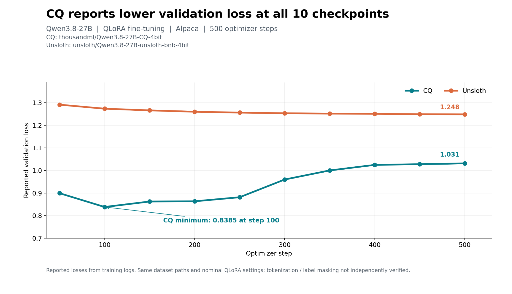
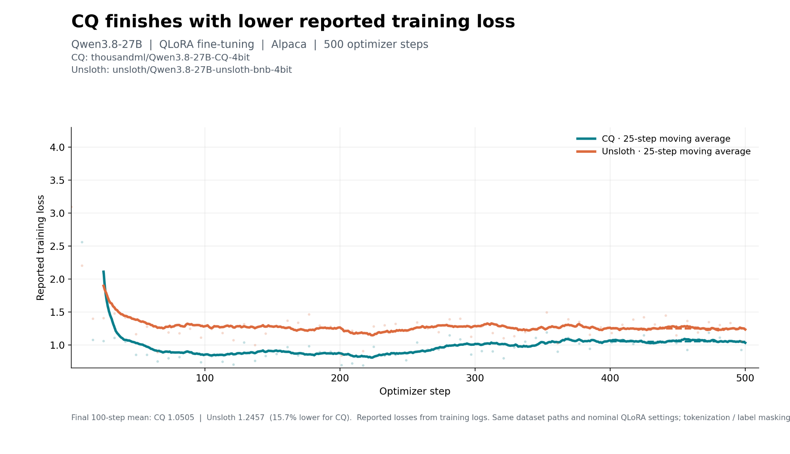

# Training Factory

**QLoRA fine-tuning on compact CQ 4-bit models — from training to LoRA-enabled inference.**

Training Factory by [ThousandML](https://www.thousandml.com) helps developers adapt open language models using **CQ (Coded Quantization)**, our calibration-free 4-bit quantization technology. Rather than restoring the stored base model to a full-precision checkpoint, Training Factory keeps the CQ base frozen and trains lightweight LoRA adapters. The repository brings quantization, fine-tuning, and inference workflows together.

> **Status and scope:** Training requires an architecture supported by the installed CQ loader and LoRA target mapping. Native CUDA extensions and any applicable ThousandML license must be configured. The Qwen3.8-27B commands below reflect our reported experiment; verify compatibility with your release and hardware. GPU savings and model quality depend on the workload.

## At a glance

- **4-bit frozen base + LoRA adapters:** QLoRA-style parameter-efficient fine-tuning.
- **Calibration-free CQ:** a compact quantized checkpoint to reuse across tasks.
- **Model serving:** CQ-enabled vLLM inference, with LoRA adapter serving where supported by your runtime.
- **Reproducible benchmarks:** Qwen3.8-27B quantization fidelity and Alpaca fine-tuning versus Unsloth bitsandbytes NF4.

## Quick start — fine-tune a CQ 4-bit model

**Requirements:** Linux x86-64 or WSL2, NVIDIA GPU with CUDA access, Conda, Python 3.12-compatible CQ native binaries, and a ThousandML license if required by the distribution.

```bash
git clone https://github.com/thousandml/training-factory.git
cd training-factory
chmod +x install.sh
./install.sh

hf download thousandml/Qwen3.8-27B-CQ-4bit \
  --local-dir ./models/Qwen3.8-27B-CQ-4bit

# Tiny smoke-test dataset
cat > train.jsonl <<'JSONL'
{"text":"Question: What does LoRA train? Answer: Small task-specific adapter weights."}
{"text":"Question: What is a quantized base model? Answer: A model stored using reduced-precision weights."}
JSONL

python training/train.py \
  --model ./models/Qwen3.8-27B-CQ-4bit \
  --data train.jsonl \
  --output ./outputs/smoke \
  --targets q_proj,v_proj \
  --kernel-module cq.cq_kernels \
  --max-steps 2 --max-length 128 --batch-size 1 --grad-accum 1
```

A smoke test checks basic functionality, not model quality. Native extensions must match your Python, CUDA, and PyTorch environment.

## Benchmarks: CQ 4-bit vs. Unsloth NF4 on Qwen3.8-27B

We compared [`thousandml/Qwen3.8-27B-CQ-4bit`](https://huggingface.co/thousandml/Qwen3.8-27B-CQ-4bit) with [`unsloth/Qwen3.8-27B-unsloth-bnb-4bit`](https://huggingface.co/unsloth/Qwen3.8-27B-unsloth-bnb-4bit). These are two separate experiments: (1) quantized-base fidelity on WikiText-2 and (2) QLoRA fine-tuning on Alpaca.

### 1. Quantized-base fidelity — WikiText-2

Lower KL divergence is better; higher top-1 agreement is better. These are results reported by ThousandML, not independently reproduced here.

| Metric | CQ 4-bit | Unsloth bitsandbytes NF4 |
|---|---:|---:|
| Checkpoint disk size | **18 GB** | 22.4 GB |
| Mean KL divergence ↓ | **0.02823666** | 0.03297115 |
| Median KL divergence ↓ | **0.01282929** | 0.01437706 |
| 99th-percentile KL divergence ↓ | **0.97606068** | 1.18053893 |
| Top-1 prediction agreement ↑ | **92.419%** | 91.954% |

**Summary:** In this test, CQ's checkpoint was approximately **19.6% smaller** and had **14.4% lower mean KL divergence**. Fidelity metrics compare predictions with a reference model; they do not, by themselves, prove better downstream task performance.

### 2. QLoRA fine-tuning — Alpaca

Both experiments used **Qwen3.8-27B**, a **single NVIDIA A40 48 GB GPU**, and the same nominal training setup:

| Setting | Value |
|---|---|
| Method | QLoRA-style LoRA training on frozen 4-bit base |
| Dataset | Alpaca training and validation JSONL |
| LoRA targets (CQ) | `q_proj,k_proj,v_proj,o_proj,gate_proj,up_proj,down_proj` |
| LoRA rank / alpha / dropout | 32 / 32 / 0 |
| Per-device batch size / accumulation | 2 / 4 (effective batch 8 examples) |
| Max sequence length | 512 tokens |
| Learning rate | 2e-5 |
| Seed | 42 |
| Optimizer steps | 500 |
| Evaluation interval | Every 50 optimizer steps |
| Benchmark warmup | 10 optimizer steps excluded |

| Metric | CQ 4-bit | Unsloth NF4 | Lower is better |
|---|---:|---:|---|
| Best reported validation loss | **0.8385** | 1.2484 | CQ |
| Final reported validation loss | **1.0315** | 1.2484 | CQ |
| Mean training loss, steps 401–500 | **1.0505** | 1.2457 | CQ |
| Median steady optimizer-step time | 27.60 s | **3.20 s** | Unsloth |
| Peak PyTorch allocated GPU memory | 24.39 GiB | **23.83 GiB** | Unsloth |

CQ's **final reported validation loss was 17.4% lower** (1.0315 versus 1.2484), and it reported lower validation loss at all ten checkpoints. CQ's lowest validation loss occurred at step 100 and then increased; this may reflect overfitting or differences in evaluation behavior, not proven faster convergence to better downstream quality. **Unsloth was substantially faster**, and its measured peak PyTorch allocation was slightly lower.

#### Validation loss across 500 optimizer steps



#### Training loss across 500 optimizer steps



> **Comparability caveat:** The experiments used matched nominal hyperparameters and dataset paths, but identical tokenization, prompt formatting, supervised-token masking, and evaluation-loss definitions have **not** been independently verified. Consequently, differences in reported loss should not be interpreted as proof of superior downstream model quality. The original CQ trainer documentation notes loss over all non-padding tokens, including prompt tokens. The two pipelines may differ in how loss is computed.

### Reproduce the Alpaca QLoRA comparison

Run from the repository root after installation. Ensure `training/examples/alpaca_train.jsonl` and `training/examples/alpaca_val.jsonl` exist and that the CQ checkpoint has been downloaded. These commands reflect the runs used for the results above.

**CQ:**

```bash
hf download thousandml/Qwen3.8-27B-CQ-4bit \
  --local-dir ./models/Qwen3.8-27B-CQ-4bit

python training/train.py \
  --model ./models/Qwen3.8-27B-CQ-4bit \
  --data training/examples/alpaca_train.jsonl \
  --eval-data training/examples/alpaca_val.jsonl \
  --output ./outputs/qwen38-27b-cq-r32-comparison-v4 \
  --kernel-module cq.cq_kernels \
  --targets q_proj,k_proj,v_proj,o_proj,gate_proj,up_proj,down_proj \
  --rank 32 --alpha 32 --lora-dropout 0 \
  --batch-size 2 --grad-accum 4 \
  --max-length 512 --max-steps 500 \
  --learning-rate 2e-5 --seed 42 --eval-steps 50 \
  --comparison-logs --benchmark --benchmark-warmup-steps 10
```

**Unsloth:**

```bash
python training/train_unsloth_nf4.py \
  --model unsloth/Qwen3.8-27B-unsloth-bnb-4bit \
  --train-data training/examples/alpaca_train.jsonl \
  --eval-data training/examples/alpaca_val.jsonl \
  --output ./outputs/qwen38-27b-unsloth-nf4-r32-v5 \
  --max-steps 500 --max-length 512 \
  --eval-steps 50 --save-steps 100 \
  --seed 42 --benchmark-warmup-steps 10
```

## Why fine-tune a quantized base?

- **Compact frozen base:** CQ stores base weights in a 4-bit representation, reducing their storage footprint. Activations, adapter parameters, optimizer state, and temporary buffers still consume GPU memory.
- **Reusable checkpoint:** Train task-specific LoRA adapters against a shared CQ base rather than storing a full-precision fine-tuned model for every task.
- **Integrated workflow:** Quantize supported models, train adapters, and serve through CQ-enabled inference tools.

**Only the LoRA adapters are trained.** This is not full-parameter fine-tuning, nor does it mean all computation occurs at 4-bit precision.

## Train on your own data

Supported training JSONL forms include:

```json
{"text":"Question: When does the warranty expire? Answer: Check the purchase date and warranty terms."}
```

or conversation records:

```json
{"messages":[{"role":"user","content":"Summarize LoRA in one sentence."},{"role":"assistant","content":"LoRA trains small adapter matrices while the base stays frozen."}]}
```

The trainer applies the tokenizer's chat template to `messages`. In the documented CQ implementation, loss is computed over non-padding tokens, including prompt/user tokens, rather than assistant-only tokens.

```bash
python training/train.py \
  --model ./models/Qwen3.8-27B-CQ-4bit \
  --data train.jsonl \
  --output ./outputs/my-lora \
  --kernel-module cq.cq_kernels \
  --targets q_proj,v_proj \
  --rank 16 --alpha 32 \
  --epochs 1 --max-length 1024 \
  --batch-size 1 --grad-accum 16 \
  --learning-rate 2e-4
```

Adapters are saved separately in PEFT-compatible form (e.g., `adapter_model.safetensors` and `adapter_config.json`). Do not merge them into the frozen CQ base with `merge_and_unload()`.

| Option | Purpose |
|---|---|
| `--model` | CQ checkpoint directory |
| `--data` | Training JSONL |
| `--output` | Adapter/checkpoint output |
| `--targets` | LoRA projection names |
| `--rank`, `--alpha` | LoRA configuration |
| `--max-steps` / `--epochs` | Training duration |
| `--max-length` | Sequence length |
| `--batch-size`, `--grad-accum` | Effective batch size |
| `--learning-rate` | Optimizer learning rate |
| `--resume` | Resume a checkpoint |
| `--kernel-module` | `cq.cq_kernels` |

For all supported options run `python training/train.py --help` after setting up any required license.

## Quantize a model (optional)

If you already have a CQ checkpoint, skip this step.

```bash
./quantize-model YOUR_ORG/Qwen3.8-27B --output-dir ./quantized_models

python build_convert_upload.py \
  --model YOUR_ORG/Qwen3.8-27B \
  --repo-id YOUR_USERNAME/Qwen3.8-27B-CQ-4bit \
  --no-upload
```

Quantization is calibration-free for compatible models. Verify the produced manifest and shards; uploading to Hugging Face requires authentication and an explicit upload action.

## Serve CQ models and LoRA adapters with vLLM

Serve a compatible CQ base:

```bash
vllm serve ./models/Qwen3.8-27B-CQ-4bit --quantization cq
```

Where your installed CQ/vLLM build supports LoRA injection and target mapping, serve an adapter:

```bash
vllm serve ./models/Qwen3.8-27B-CQ-4bit \
  --quantization cq \
  --enable-lora --max-lora-rank 16 \
  --lora-modules my-lora=./outputs/my-lora
```

Confirm the adapter is listed, then call it by name:

```bash
curl http://localhost:8000/v1/models

curl http://localhost:8000/v1/chat/completions \
  -H 'Content-Type: application/json' \
  -d '{
    "model": "my-lora",
    "messages": [
      {"role":"system","content":"You are a helpful assistant."},
      {"role":"user","content":"Explain how LoRA fine-tuning works in one sentence."}
    ],
    "max_tokens":128,
    "temperature":0.2
  }'
```

Do not assume adapter serving works solely because training succeeded; validate predictions with your deployment build. The `--max-lora-rank` must accommodate the adapter's rank (e.g., use 32 or higher for the r=32 benchmark adapters).

## CQ 4-bit checkpoints

- [`thousandml/Qwen3.8-27B-CQ-4bit`](https://huggingface.co/thousandml/Qwen3.8-27B-CQ-4bit)
- [`thousandml/Llama-3.1-8B-Instruct-CQ-4bit`](https://huggingface.co/thousandml/Llama-3.1-8B-Instruct-CQ-4bit)
- [`thousandml/Llama-3.3-70B-Instruct-CQ-4bit`](https://huggingface.co/thousandml/Llama-3.3-70B-Instruct-CQ-4bit)
- [`thousandml/Qwen3-Coder-Next-CQ-4bit`](https://huggingface.co/thousandml/Qwen3-Coder-Next-CQ-4bit)

Compatibility and GPU requirements vary by model and installed runtime.

## Installation checks and troubleshooting

```bash
python -c "import torch, peft, transformers, cq.cq_kernels; print('CUDA:', torch.cuda.is_available())"
python -m pip check
```

- Use Python 3.12 with native binaries built for the same Python ABI.
- The kernel import path is `cq.cq_kernels`, not top-level `cq_kernels`.
- CUDA driver, toolkit, PyTorch, and extensions must be compatible.
- A license key/server may be required (`CQ_LICENSE_KEY`, `CQ_LICENSE_URL`).
- If a script checked out on Windows fails with `bash\r`, normalize line endings: `sed -i 's/\r$//' install.sh`.
- Measure memory, throughput, and quality on your actual workloads before making production cost claims.

## Contributing and feedback

We welcome reproducible bug reports, hardware measurements, model-compatibility reports, and benchmark improvements. Open an [issue](https://github.com/thousandml/training-factory/issues) or share your results. Our current priorities include CQ training-kernel throughput and broader downstream quality evaluation.

**ThousandML — Making Every Bit Count.**
